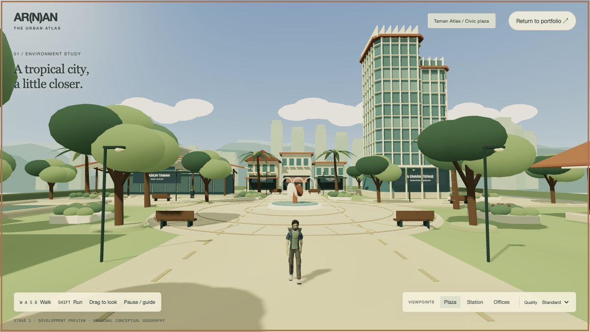
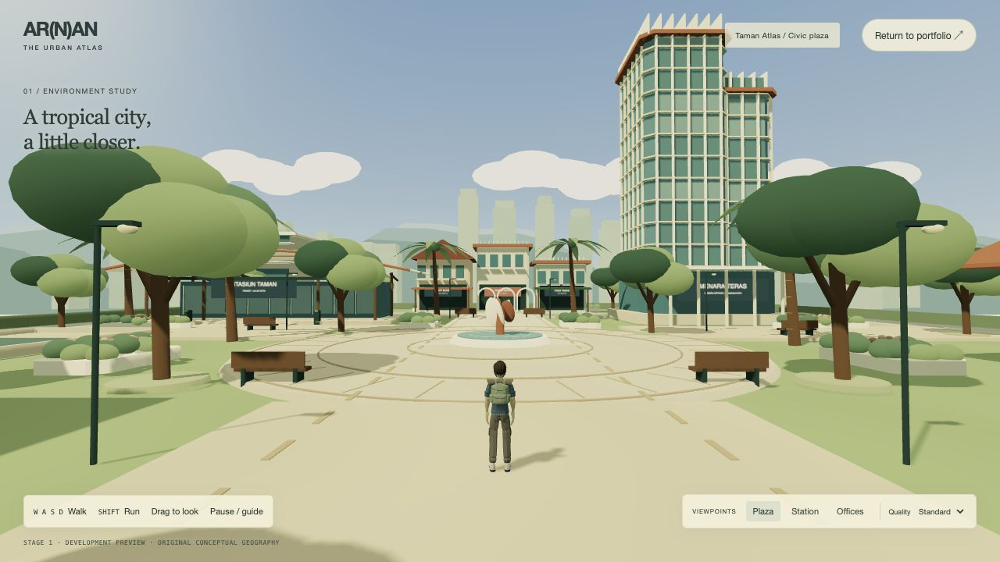
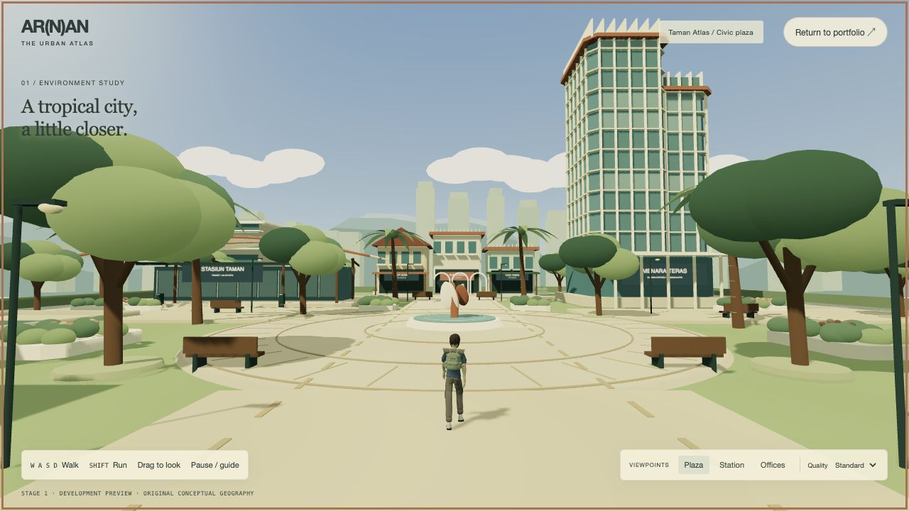
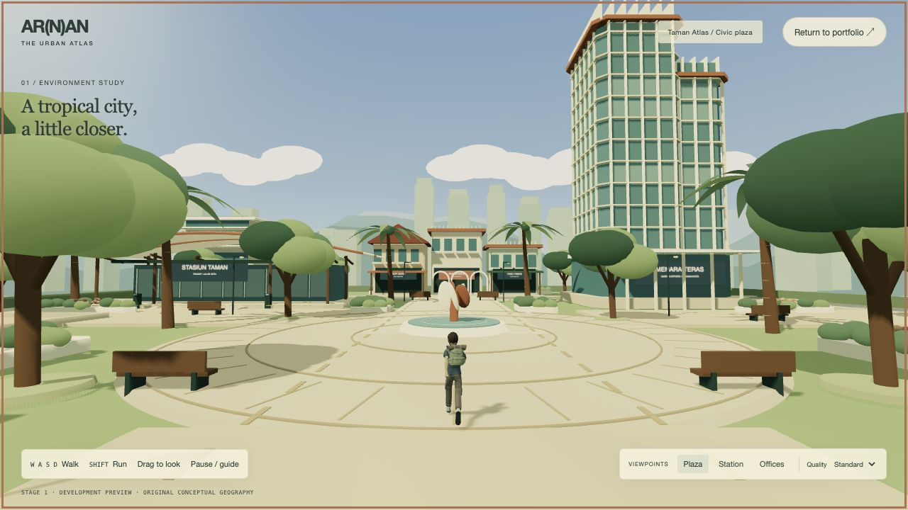

# Urban Atlas — imported character overhaul

## Result and scope

The procedural primitive figure has been removed from the Urban Atlas preview.
It is replaced by the real **Adventurer** from Quaternius’s
[Ultimate Modular Men pack](https://quaternius.com/packs/ultimatemodularcharacters.html),
licensed **CC0 1.0** on both the official page and downloaded license notice.
The city, architecture, landscaping, portfolio pages, navigation and collision
infrastructure were not redesigned. This updates `urban-atlas.html`, not the
separate earlier integrated RPG experiment on Home.

The explorer wears a muted blue jacket, olive backpack, neutral trousers and
cream footwear. Geometry, hair, face, fingers, pack, skeleton, inverse bind
matrices and vertex skin weights are imported from the selected asset. There are
no procedural replacement body parts. No Nintendo/proprietary character content
is used.

## Selection and verified sources

| Source evaluated | Decision |
| --- | --- |
| [Ultimate Modular Men](https://quaternius.com/packs/ultimatemodularcharacters.html) | Selected Adventurer: finished civilian traveler, jacket, shoes, backpack, humanoid rig and matching locomotion clips. Official public folder includes glTF; no FBX conversion needed. |
| [Animated Men](https://quaternius.com/packs/animatedmen.html) | Older four-character pack; supplied FBX/OBJ/Blend formats would add conversion work. |
| [Universal Base Characters](https://quaternius.com/packs/universalbasecharacters.html) | Customizable base forms, approximately 13k triangles; ready civilian clothing in the selected pack better fits this task. |
| [Universal Animation Library](https://quaternius.com/packs/universalanimationlibrary.html) | Available CC0 animation option; not imported because matching native clips already exist, avoiding unnecessary retargeting. |

Actual original source:
`Individual Characters/glTF/Adventurer.gltf`, exported with Khronos glTF Blender
I/O v1.7.33. The download and checksums are recorded in
`assets/game/characters/urban-explorer/source.json`.

- 62-joint humanoid skeleton, including fingers.
- 10,202 triangles across 15 skinned material primitives.
- 1,581,480-byte, self-contained GLB; no external texture/buffer requests.
- Three clips: source `Idle_Neutral` renamed `Idle`, plus `Walk` and `Run`.
- Original license: `assets/game/characters/urban-explorer/CC0-Quaternius.txt`.

The alternative Casual_2 source was also downloaded temporarily for comparison.
It is not shipped. No FBX converter, Blender install, paid asset or remote runtime
asset service is required.

## Asset pipeline and rendering

`scripts/prepare-atlas-character.mjs` verifies the reviewed source checksum and
pinned tool versions, selects the matching clips, guards against horizontal Root
motion, adapts material colors/roughness and deduplicates/prunes unused data into
one GLB. It does not retarget or alter bind poses, vertex weights or geometry.
The source uses material colors and has no texture or normal maps to replace.
Imported MeshStandardMaterial instances remain intact; the character does not
receive the environment's custom toon shader. Matte surfaces, the shared palette,
lighting and tone mapping provide visual consistency without breaking skinning.

The official Three.js GLTFLoader, AnimationMixer and Box3 are added to the same
pinned 0.180.0 vendor bundle used by this preview. There is no second Three.js
runtime. MIT notices are retained. The bundle checksum is updated in
`assets/js/urban-atlas/ASSET-PROVENANCE.md`.

Runtime model URL is resolved relative to the ES module with `new URL(...)`.
It works under root hosting and GitHub Pages repository subpaths. The preview
waits for the real GLB before revealing/starting the world. Loading failure shows
the existing fallback; it never substitutes a procedural figure. Partial loading
failure cleans up the renderer and district resources.

## Movement, animation and camera

- `player-controller.js` owns a stable unanimated physics root, acceleration,
  turning, collision and existing ground-height support.
- `character.js` loads the skinned model under a separate visual child, normalizes
  its height to 1.90 m, corrects the source floor offset, and preserves +Z forward.
- `animation-controller.js` uses AnimationMixer with continuously running actions
  and exponentially smoothed weights (120 ms blend constant). Gait phases are
  matched on walk/run changes instead of restarting animations every frame.
- Playback rates use achieved post-collision speed, not just held keys. Blocking a
  movement therefore blends back to idle. Idle feet use the source's fixed planted
  foot tracks. Animated bones never drive the follow camera's root.
- Walking is calibrated to 2.1 m/s and running to 4.6 m/s. Native stance-speed
  measurements are approximately 1.20 / 2.695 model units/s, adjusted by model
  scale. Slower movement than the earlier primitive prototype is intentional to
  match the supplied gait without comically fast animation or excessive sliding.
- Follow distance changes modestly from 8.8 to 8.2 m and look target from 3.6 to
  3.35 m. The model remains a small portion of the view, leaving the city visible.
  Existing damping and obstruction handling remain in place.
- Animation, bone textures and shared geometry/materials are disposed with the
  preview lifecycle. Pause freezes animation and movement; hidden/inactive pages
  retain the existing loop-stop behavior.

Controls are unchanged: WASD/arrows move, Shift runs, drag orbits, Escape pauses.
Touch direction buttons continue using the same movement API. Reduced motion
suppresses extra environment/camera effects while preserving authored locomotion.

## Running and reproducibility

No build or package install is required to run the committed static assets:

```sh
python3 -m http.server 4173 --bind 127.0.0.1
```

Open `http://127.0.0.1:4173/urban-atlas.html` and choose Enter the district.
Refreshing requires a fresh explicit entry and reloads the bundled GLB correctly.

To intentionally rebuild the model from the reviewed original download:

```sh
npm install --prefix /tmp/atlas-character-build --ignore-scripts @gltf-transform/core@4.2.1 @gltf-transform/functions@4.2.1
node scripts/prepare-atlas-character.mjs --source /absolute/path/Adventurer.gltf --deps /tmp/atlas-character-build/node_modules
```

Rebuild the renderer with the existing pinned temporary `three@0.180.0` and
`esbuild@0.25.10` dependencies:

```sh
node scripts/build-atlas-vendor.mjs --deps /absolute/path/node_modules
```

Update its provenance checksum if intentionally changing the vendor build.
`mountUrbanAtlas()` is now asynchronous; callers must await it. The current
preview controller has been updated accordingly. No Stage 2 integration was added.

## Executed verification

- 21 Node tests pass: 5 new character tests, 9 district tests, 7 prior integration
  tests. The tests parse the actual GLB with the actual vendored GLTFLoader.
- Verified binary/source checksum, embedded buffers, clip set, genuine SkinnedMesh
  geometry, 62-joint bind data, normalized vertex weights, human scale and source
  standard materials.
- Verified continuous animation weights/phase progression, displacement-derived
  playback rate, fixed idle foot positions, stable physics root, and idle at walls.
- Syntax and whitespace checks pass for changed/new source files.
- Real in-app Chromium browser: model loading after refresh, front/rear inspection,
  W/S/A/D, Shift running, turning, camera following/drag, floor support and collision.
- Station walking stopped at z=-10.909, y=0.520 on the raised platform and settled
  to Idle. Lateral D/A movement returned x to approximately 0.014 from zero.
- Live native held-key captures confirmed Walk at clip time 0.459 and Run at 0.316.
  Screenshots were captured while the keys were held, not from a fake pose switch.
- No character preview console errors or warnings were observed.
- Static audit continues to report the same 58 inherited failures, identical to
  the untouched source; this is not a passing production release gate.

## Files changed or added for this correction

- Replaced `assets/js/urban-atlas/character.js` with the GLB visual loader.
- Added `assets/js/urban-atlas/player-controller.js` and `animation-controller.js`.
- Updated `entry.js`, `preview.js`, `camera.js`, and the preview script version in
  `urban-atlas.html` for asynchronous loading, cleanup and framing.
- Extended `scripts/build-atlas-vendor.mjs` and regenerated `three-atlas.module.js`.
- Added `scripts/prepare-atlas-character.mjs` and the GLB/license/manifest asset folder.
- Added `tests/atlas-character.test.mjs`; updated the existing character movement
  test to exercise the actual imported asset.
- Updated asset provenance and marked the original Stage 1 character record as
  historical. Added this handoff and `docs/character-review/*.jpg`.

No city construction modules, portfolio content or publishing settings were changed.
No commit, push, deployment or Stage 2 integration was performed.

## Remaining limitations

This uses the source pack's stylized, angular face/hair and authored animations;
there is no facial performance rig, inverse-kinematic foot placement or terrain
retargeting. Speed calibration reduces steady-state foot sliding, but small skids
can remain during acceleration, blends and tight turns. Wall and ground collision
remain the existing lightweight controller rather than a full physics capsule.
Physical mobile hardware, forced GPU-context loss and all browser engines were
not tested in this character pass. The earlier separate homepage RPG experiment
still uses its earlier character; this request updates only the Urban Atlas preview.

## Actual browser captures

Front:



Rear third-person:



Walking (live input):



Running (live Shift input):


