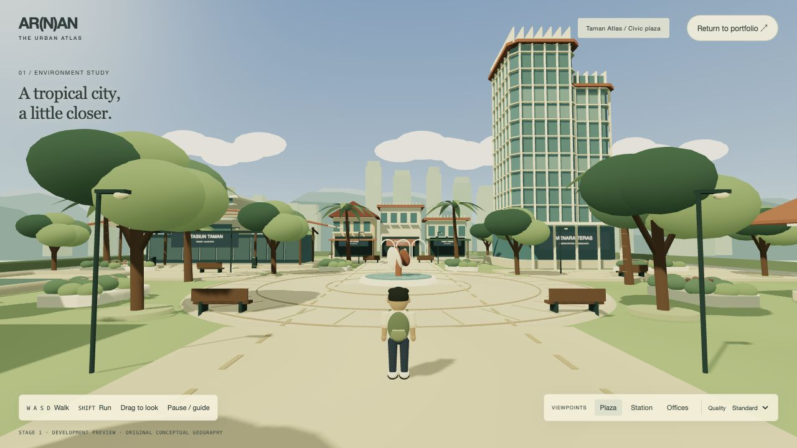
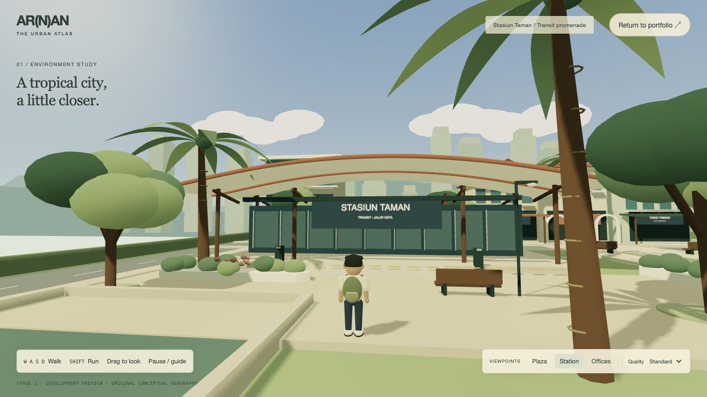
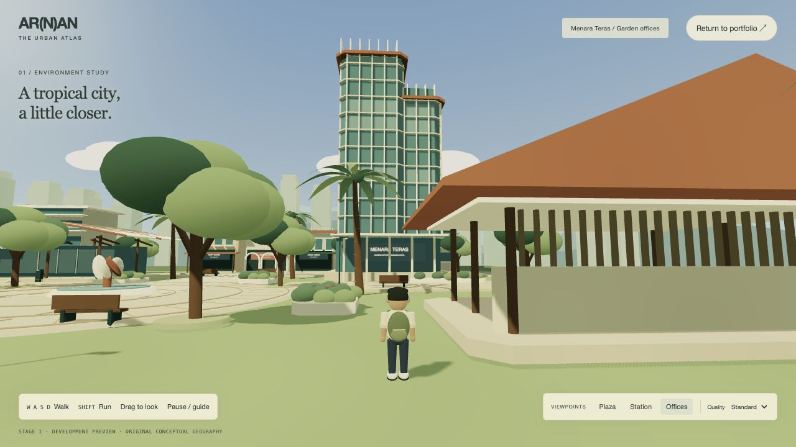

# The Urban Atlas — Stage 1 visual specification

> Historical implementation record. The current Home/Work integration, assets
> and validation are documented in [Living Atlas](LIVING-ATLAS.md) and
> [Phase 1–2 QA](LIVING-ATLAS-QA.md). Earlier mission UI and separate game entry
> described here are not part of the current public experience.

**Historical Stage 1 record:** the procedural character described and pictured
below has since been replaced by a licensed skinned Quaternius model. See
[Character overhaul](CHARACTER-OVERHAUL.md) for current assets, animations and tests.
The mounting entry is now asynchronous: `await mountUrbanAtlas(host, options)`.

## Scope

An isolated opt-in development preview at `urban-atlas.html`. The professional
portfolio and the preceding integration work are left untouched. No missions,
research state, NPC systems or portfolio UI are added. Stop here for visual review
before any Stage 2 integration.

## Composition

A compact, authored tropical civic district, approximately 90 × 90 conceptual
metres. Spawn on the south edge of a stone civic plaza, looking through shade
canopies toward two distinct silhouettes: the low sweeping west station and the
tall stepped east office garden. A planted central axis leads north into a shaded
shop street; two perimeter streets establish a clear traffic hierarchy. A west
promenade overlooks a sunken rain garden. Mountain ridges and a hazy city skyline
frame the landmarks without pretending to represent real geographic positions.

## Architecture

- **Stasiun Taman:** parallel flowing shell roofs, deep eaves, slender structural
  ribs, clerestory glazing, shaded platforms and a transit entrance at plaza level.
- **Menara Teras:** a chamfered, stepped office landmark, blue-green glazing,
  vertical ivory fins, horizontal sun shelves, terracotta crown and planted terraces.
- **Shop street:** three families of narrow shophouses: terracotta tiled gables,
  flat tropical verandas and arched plaster arcades. Repeated modules vary in
  proportion, awning, facade rhythm and planting rather than random placement.
- **Civic pavilion:** a broad folded tropical roof, timber-like battens and an
  open colonnade facing the plaza.

## Character and movement

Original urban explorer: short dark hair, cream overshirt over a muted coral top,
indigo trousers, trainers and a small sage daypack. Sculpted parametric body parts,
rounded joints, a face and a deliberate silhouette. Continuous animation blends
between breathing/weight shift, walking, and a faster forward-leaning run. Ground
movement uses acceleration, damping, smooth facing, collision.
The follow camera uses a low adventure-game framing, drag orbit and obstruction
rays, with fast inward/slow outward damping.

## Rendering and atmosphere

Soft-banded toon materials with a configurable shared lighting ramp. Warm ivory,
terracotta, oxidized teal, sage and deep forest green. A procedural gradient sky,
painted-looking clouds, pale mountain silhouettes, distance fog, golden directional
light, cool ambient fill and restrained soft shadows. No bloom or heavy effects.
Subtle leaf movement and water shimmer only; respect reduced motion.

## Asset strategy and budget

Original parametric meshes: shell surfaces, extruded footprints, gabled roofs,
arches, palm fronds, shaped canopy clusters, lathed character clothing. No remote
models, texture downloads or game-asset dependencies. Typography on wayfinding is
rendered locally to small canvas textures. Trees, paving accents and repeated
facade elements share geometry/materials or use instancing where appropriate.

Initial budget: under 1 MB renderer/module transfer excluding compression, under
250k submitted triangles and roughly 650 draw calls at the spawn view; one shadow
map, capped device pixel ratio, shadows off on compact devices. These are budgets,
not achieved performance claims; measured output is recorded after browser QA.


## Running the playable preview

From the repository root:

```sh
python3 -m http.server 4173 --bind 127.0.0.1
```

Open `http://127.0.0.1:4173/urban-atlas.html`, then choose **Enter the district**.
No npm install, runtime network asset service, backend or build step is needed.
The preview is marked noindex and has no new links from production pages. The
existing Explore in 3D button still opens the earlier integration experiment;
this new environment remains separate until Stage 2 is explicitly approved.

Controls: WASD/arrows walk, Shift runs, mouse/touch drag rotates and elevates the
camera, Escape pauses/opens the guide. Compact screens expose hold-to-walk buttons.
The three review viewpoint buttons relocate the character and reset camera framing.
Eco quality disables shadows and lowers device pixel ratio. Normal mode caps pixel
ratio at 1.5; compact initial loading caps it at 1.25 with shadows disabled.

## Architecture and Stage 2 mounting preparation

`assets/js/urban-atlas/entry.js` exports `mountUrbanAtlas(host, {onError})`.
The host supplies a canvas and optional `[data-move]` buttons. The returned object
exposes `start()`, `stop()`, `destroy()`, `setPaused(value)`, `setQuality(eco)` and
`goToViewpoint(name)`. Escape dispatches `atlas:pause` on the host for the caller's
own minimal UI. The scene has no project registry, mission, URL or portfolio-DOM
coupling. In Stage 2, the existing portfolio can dynamically import this entry and
own its mounting, accessibility and navigation lifecycle. That integration has
not been performed in this stage.

The renderer owns one RAF loop, stops when inactive/hidden, resizes with its host,
and disposes shared geometry/materials/textures when destroyed. Rendering uses
instanced static primitives for repeated details, custom shell/arch/extrusion
meshes for architecture, and an articulated original character. Collision uses
bounded swept substeps and wall sliding. Camera rays operate on world-space solids,
including separate overhead-only roof volumes. Reduced motion disables ambient
movement and limb bobbing, and removes camera following interpolation.

## Files added by this stage

- `urban-atlas.html`: isolated opt-in preview entry and minimal controls.
- `assets/css/urban-atlas.css`: responsive development preview styling.
- `assets/js/urban-atlas/entry.js`, `preview.js`: mount lifecycle and preview-only UI.
- `assets/js/urban-atlas/scene.js`, `layout.js`: district setup and authored placement.
- `assets/js/urban-atlas/architecture.js`, `geometry.js`: architectural systems.
- `assets/js/urban-atlas/environment.js`, `materials.js`: landscape and rendering.
- `assets/js/urban-atlas/character.js`, `input.js`, `camera.js`, `collision.js`:
  original character, locomotion, controls and obstruction handling.
- `assets/js/vendor/three-atlas.module.js`: isolated MIT renderer bundle.
- `scripts/build-atlas-vendor.mjs`: reproducible optional vendor build.
- `tests/urban-atlas.test.mjs`: nine focused geometry/gameplay/isolation tests.
- `assets/js/urban-atlas/ASSET-PROVENANCE.md`: original assets and renderer license.
- `docs/URBAN-ATLAS-STAGE-1.md`: specification and handoff.
- `docs/urban-atlas-review/{plaza,station,commercial}.jpg`: actual browser captures.

Existing production files, publishing settings and earlier work were not changed
by this stage. No commit, push or deployment was performed.

## Executed validation and visual review

Real Codex in-app Chromium browser at 1280×800, 1280×720 and 390×844.
Final saved review captures are 1280×720. Captures below are actual
playable renders, not mockups. The browser's ordinary capture clipped the current
side-panel width, so full-page captures were used to record the complete viewport.
All three saved images were opened and visually inspected after final changes.
Temporary viewport overrides were reset after testing.

- Held W for two seconds: plaza z changed from 28 to 20.684. Shift+W for one second
  moved about 7.19 metres, versus walking speed about 3.65 metres/second.
- Walked under the station canopy toward the solid façade. The character stopped
  at z=-10.910 and remained at that boundary under continued forward input.
- Ground support was checked in the browser: walking up the station access ramp
  placed the character at y=0.520 on the platform, matching its surface.
- Escape opened the guide, blocked movement while paused, and closed/resumed.
- Camera drag, all three review viewpoints, and Eco selection worked in the browser.
- A 1000 ms held mobile direction button changed z from 28 to 24.339 at 390×844.
- No errors or warnings were observed in the preview console.
- Professional Home was opened independently and retained its content/navigation.
- Nine Stage 1 tests pass; seven prior integration tests also pass (16 total).
  Tests include real district collision/reachability, a camera-aliasing regression,
  roof winding normals, locomotion, substeps, obstruction and isolation.
- JavaScript syntax checks pass for all 14 Stage 1 source/build/vendor files.
  Tracked and newly added text files pass whitespace checks.
- The original static audit still fails with the same 58 inherited issues.
  Its output was compared with the untouched downloaded source and is identical;
  it must not be described as a passing release gate.

Visual fixes made during review: matched ground support to paved surfaces and the station ramp; kept the office crown inside the spawn framing;
removed roof/foliage shadow acne; corrected shell winding; cleared the central
station approach; corrected a camera vector-aliasing issue that put a commercial
viewpoint inside the character; added separate overhead camera collision solids.

Observed short desktop samples were approximately 91k–99k triangles and 223–258
render calls, with a two-second FPS diagnostic reporting 180 on this local browser.
These are observations, not a sustained performance guarantee. Physical mobile
hardware, forced WebGL/context-loss scenarios and OS-level reduced-motion toggling
were not tested. WebGL initialization/context-loss error handling is implemented.

## Remaining visual and simulation limits

This is a compact stylized environment ready for visual review, not a final asset
production pass. The sky/clouds and distant skyline are intentionally simplified;
foliage uses shaped clusters and fronds rather than individual textured leaves.
The character has authored procedural animation rather than a skinned performance
capture. Ground follows analytic paved surfaces and the station access ramp; there is no freeform terrain physics. The station
facade and shop doors are closed; building interiors are not traversable. Shadows
are deliberately suppressed on foliage and thin roof receivers to keep the toon
surfaces clean. Camera collisions use conservative volumes rather than exact meshes.

Potential visual revisions after review: stronger leaf/branch variation, additional
shop-window dressing, a more expressive facial rig, and further near-wall camera
tuning. Do not add Stage 2 research/UI integration until the user approves the world.

## Review captures

Spawn plaza:



Transit station:



Commercial district:


